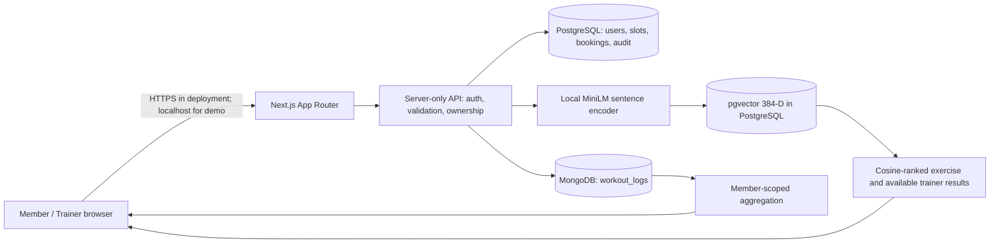
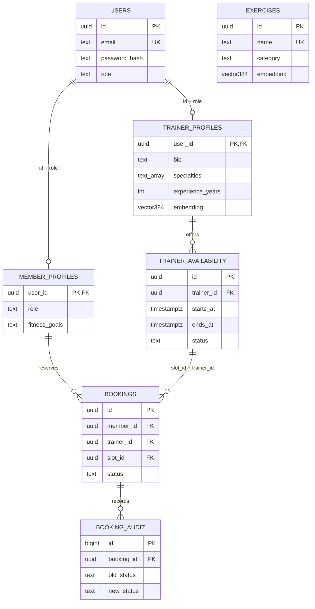
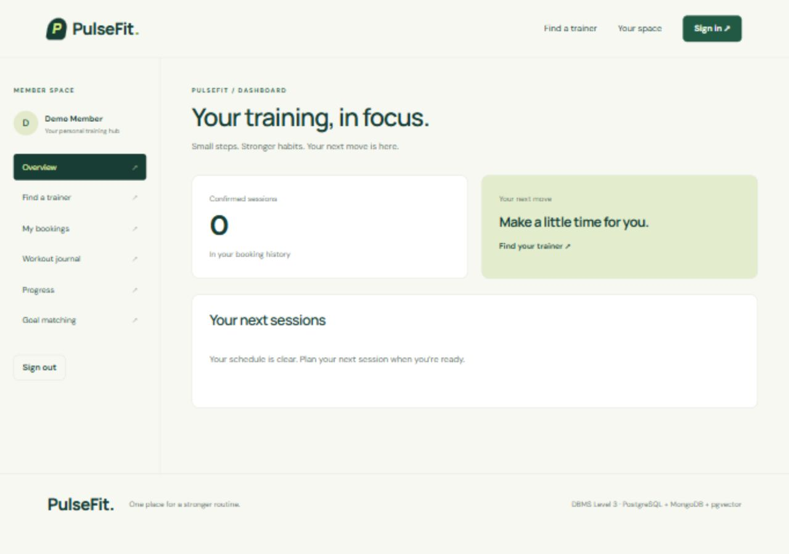
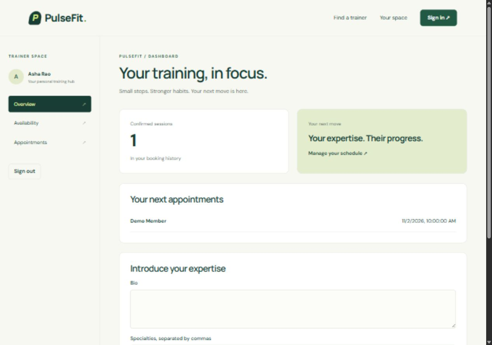
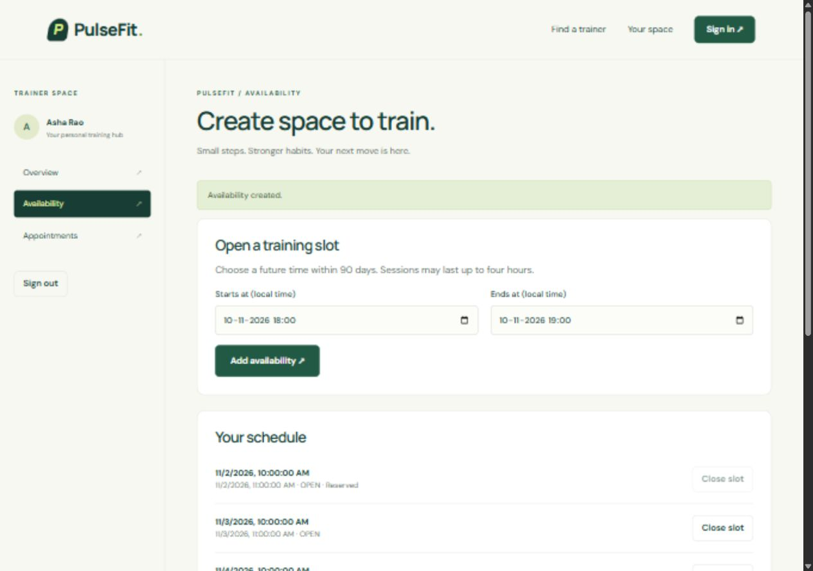
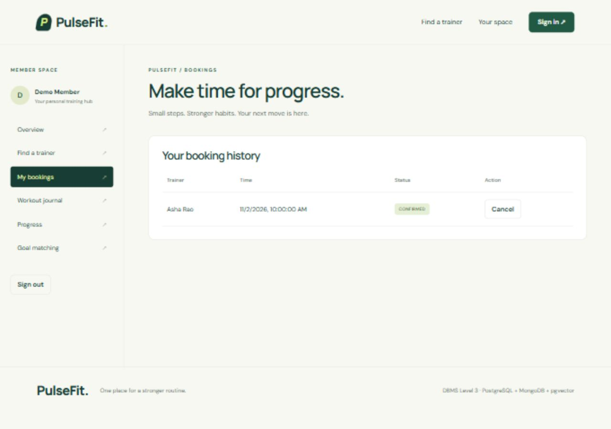
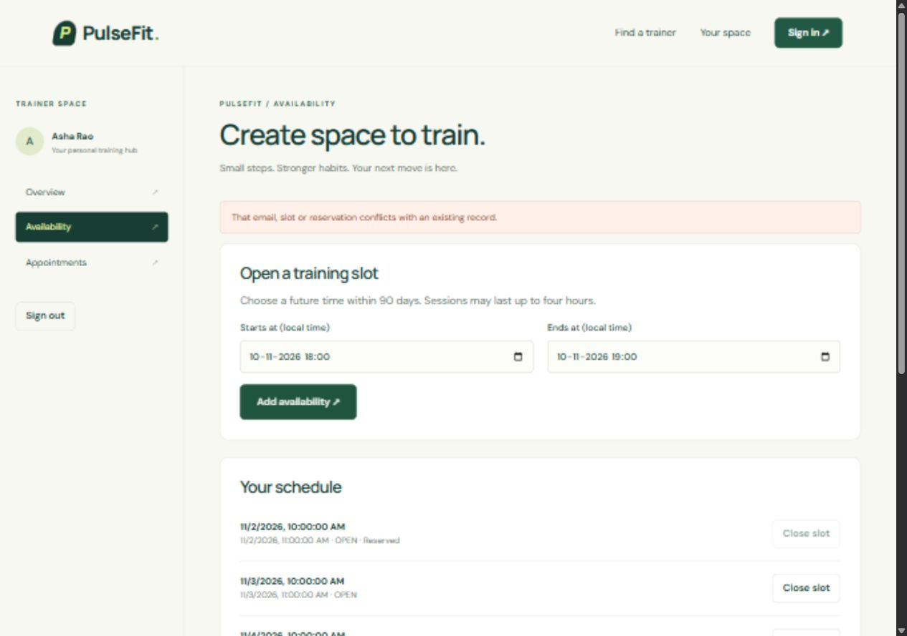
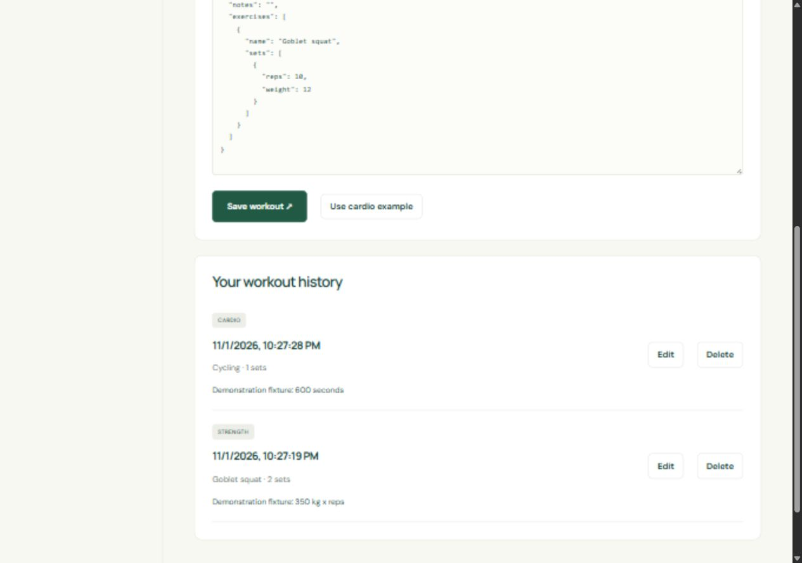
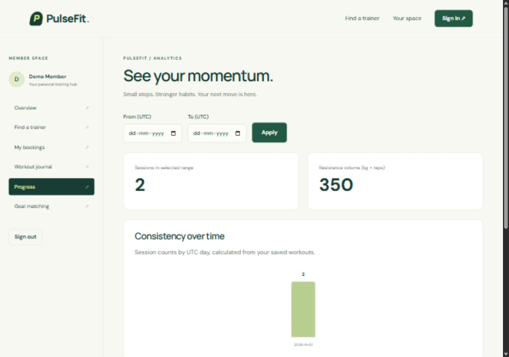

# 1. TITLE

**PulseFit – Hybrid Smart Gym & Trainer Booking System**

DBMS Experiential Learning – Level 3 Project. Evidence recorded on 1 November 2026, Asia/Calcutta.

**Student 1: Chirag Basanth Bellavi — PES1UG24CS133**

**Student 2: Chhavi Siddarth Wadhwa — PES1UG24CS132**

Repository: https://github.com/ChiragBasanth/dbms_mini_project_pulsefit

## 1.1 Problem statement

Gym members and trainers need a shared schedule that prevents simultaneous confirmed reservations, preserves cancellation history and supports workouts whose measurements differ by activity. A single rigid workout row cannot naturally represent both weighted sets and timed cardio. Members also need a way to describe fitness goals beyond selecting fixed categories.

## 1.2 Objectives and scope

Provide transactionally safe, capacity-one trainer booking; role-authorized scheduling; owned workout history and progress; and goal-to-exercise/trainer semantic matching. Scope includes local university demonstration, reproducible migrations/seeds and evidence. Payments, medical advice, administration, email delivery, public hosting and distributed cross-store transactions are outside the implementation.

# 2. STUDENTS' SRN AND NAME

Student 1: Chirag Basanth Bellavi — PES1UG24CS133

Student 2: Chhavi Siddarth Wadhwa — PES1UG24CS132

Both names and SRNs were explicitly confirmed by the user. Team approval and individual contributions remain pending confirmation. No GitHub handle was used to infer a student identity. See Appendix B and `CONTRIBUTIONS.md` for the contribution record; no individual work is attributed without evidence. This submission requires student review and instructor-policy confirmation for AI assistance.

# 3. ABSTRACT

PulseFit addresses conflicting trainer reservations and inflexible gym workout tracking through a hybrid database application. PostgreSQL stores identities, typed roles, schedules, reservations and audit history. Row-level locks, a partial unique index and a GiST interval exclusion constraint provide transactional reservation integrity. MongoDB stores variable exercise/set documents and computes member-scoped session counts, resistance volume and cardio measures. PostgreSQL pgvector stores normalized 384-dimensional MiniLM sentence embeddings for goal-based exercise and available-trainer retrieval. A Next.js interface integrates both databases through authorized server-only handlers. Local tests demonstrated one successful reservation among eight concurrent database clients, safe cancellation/rebooking, validated workout CRUD, exact fixture aggregates and semantic ranking from paraphrased text. HTTP and browser checks exercised member and trainer journeys. The implementation makes no distributed ACID claim; attributable student contributions and institutional originality approval remain outstanding.

# 4. TECH STACK

| Layer | Technology | Purpose and justification |
|---|---|---|
| Frontend | Next.js 16.4.3; React 19.2.0 | App Router, responsive role portals |
| Language | TypeScript ^5.9.3 | Strict API/component types |
| Backend | Next.js Node.js route handlers; pg; mongodb; Zod | Server-only connections, validation, parameter binding |
| SQL | PostgreSQL 18.6 portable runtime; btree_gist | Relational integrity, transactional reservations, exclusion constraints |
| NoSQL | MongoDB 8.2.6 real mongod; MongoDB driver | Variable workout/set documents and aggregation |
| Vector | pgvector 0.8.7; Transformers.js; Xenova/all-MiniLM-L6-v2 | Real normalized 384-D model embeddings and exact cosine search |
| Authentication | bcryptjs cost 12; jose HS256 JWT; HttpOnly cookies | Password hashing and signed expiring sessions |
| Testing | node:test via tsx; ESLint; tsc; browser tool | Unit, database, HTTP, production build and visible UI checks |
| Version control | Git; requested GitHub origin | Local inspectable changes; no artificial commits |
| Runtime | Node.js v26.13.0; npm 11.20.0 observed | Node 22 LTS or later documented; package-lock included |

## 4.1 Architecture and data flow



SQL was chosen for strong relational references and conflicting reservation writes. MongoDB was chosen for nested, optional strength/cardio measurements and aggregation. Vector columns share PostgreSQL identities and metadata, avoiding an extra vector service. The model runs locally after one download; no paid API or fabricated embedding fallback is present. Database secrets are never NEXT_PUBLIC variables.

## 4.2 ER diagram




Logical cross-database reference: `workout_logs.userId` stores the PostgreSQL member UUID as a string. It is not a MongoDB-enforced foreign key. Exercises embedded in logs preserve historical names and measurements even if catalog descriptions change. The optional catalog has no forced relational link to those historical snapshots.


## 4.3 Relational schema and normalization


Source of truth: ordered SQL in `database/postgres/migrations/`.

```text
users(id PK, name, email UNIQUE, password_hash, role, created_at, UNIQUE(id,role))
member_profiles(user_id PK, role='MEMBER', fitness_goals,
  FK(user_id,role) -> users(id,role))
trainer_profiles(user_id PK, role='TRAINER', bio, specialties[], experience_years,
  embedding vector(384), embedding_model, location,
  FK(user_id,role) -> users(id,role))
trainer_availability(id PK, trainer_id FK -> trainer_profiles.user_id,
  starts_at, ends_at, status, UNIQUE(id,trainer_id), GiST non-overlap exclusion)
bookings(id PK, member_id FK -> member_profiles.user_id, trainer_id, slot_id,
  status, created_at, FK(slot_id,trainer_id) -> trainer_availability(id,trainer_id))
booking_audit(id PK, booking_id FK -> bookings.id, old_status, new_status, changed_at)
exercises(id PK, name UNIQUE, muscle_group, description, difficulty, category,
  embedding vector(384), embedding_model)
schema_migrations(name PK, checksum, applied_at)
```

## Normalization rationale

User identity appears once; member and trainer properties depend on each profile's key. Availability is independent of reservations so cancellation retains history and releases the partial unique index entry. Names, times and contact data are not duplicated in bookings. Display views join current context.

Core scalar relations follow third normal form: non-key attributes describe the key and do not determine unrelated non-key attributes. `trainer_id` in bookings is deliberately redundant with slot membership to support a composite FK preventing mismatched trainers; it is not claimed to be a fully decomposed 3NF relation. Profile role columns are constrained discriminator redundancy enabling declarative role-specific foreign keys. Specialties use a bounded descriptive PostgreSQL array; this is a practical multivalued attribute, not a claim of strict classical 1NF for that field. A separate specialty relation is an appropriate future change if per-specialty attributes are needed.

## Booking invariant

Capacity is exactly one. `one_confirmed_booking_per_slot` is a partial unique index. `reserve_slot` locks the slot with `FOR UPDATE`, validates its time/status and inserts. Under the default READ COMMITTED isolation, competing calls wait; the unique index independently protects direct insert paths. The GiST exclusion constraint, rather than a cross-row CHECK, prevents overlapping availability for each trainer. Closed slots still occupy their original interval and cannot be reopened through the API; create a different non-overlapping time. Slot time and trainer are immutable after creation.

Cancellation changes an owned future booking to CANCELLED, retaining audit history; a new reservation uses a new booking row. PostgreSQL handles the operation atomically. Contention involving cancellation can cause a deadlock victim to roll back; retry the request after refreshing. No global transaction spans PostgreSQL and MongoDB.


## 4.4 Data dictionary


All columns are NOT NULL unless marked nullable. PostgreSQL UUIDs are serialized as strings; dates use ISO strings at the API and timezone-aware storage. Sources: `001_core.sql`, `002_profile_metadata.sql`, `database/mongo/setup.ts`.

| Table | Columns and types | Rules / meaning |
|---|---|---|
| users | id uuid; name text; email text; password_hash text; role text; created_at timestamptz | Generated UUID PK; name 2–100; lower(trim(email)) unique; hash ≥60 chars; MEMBER or TRAINER; creation now |
| member_profiles | user_id uuid; role text; fitness_goals text | PK and composite role FK; MEMBER only; goals default empty, ≤2000 chars |
| trainer_profiles | user_id uuid; role text; bio text; specialties text[]; experience_years int; embedding vector(384) nullable; embedding_model text nullable; location text | PK and composite role FK; TRAINER only; bio ≤2000; experience 0–80; model metadata; location ≤120 default campus gym |
| trainer_availability | id uuid; trainer_id uuid; starts_at timestamptz; ends_at timestamptz; status text | UUID PK; trainer FK; duration >0 and ≤4h; OPEN/CLOSED; insertion starts within next 90 days; non-overlapping half-open ranges |
| bookings | id uuid; member_id uuid; trainer_id uuid; slot_id uuid; status text; created_at timestamptz | PK; typed member FK; composite slot/trainer FK; CONFIRMED/CANCELLED; one confirmed row per slot; immutable identity |
| booking_audit | id bigint identity; booking_id uuid; old_status text nullable; new_status text; changed_at timestamptz | PK; booking FK; trigger-produced change trail; initial old status null |
| exercises | id uuid; name text; muscle_group text; description text; difficulty text; category text; embedding vector(384) nullable; embedding_model text nullable | PK; unique name; BEGINNER/INTERMEDIATE/ADVANCED; STRENGTH/CARDIO/MOBILITY; null embedding means not indexed |
| schema_migrations | name text; checksum text; applied_at timestamptz | Migration filename PK; SHA-256 prevents edits to applied migrations |

## MongoDB workout_logs

| Field | BSON type | Rules / meaning |
|---|---|---|
| _id | ObjectId | MongoDB identifier; serialized as 24-character hex |
| userId | string | PostgreSQL member UUID; app supplies from authenticated session |
| performedAt | date | Workout timestamp; application rejects future dates |
| createdAt | date | Server insertion timestamp |
| workoutType | string | STRENGTH, CARDIO, MIXED or MOBILITY |
| notes | string optional | ≤2000 characters |
| exercises | array | 1–30 exercise snapshots |
| exercises[].name | string | 1–100 characters |
| exercises[].sets | array | 1–30 sets, each with reps or duration |
| sets[].reps | number optional | Positive integer ≤1000 |
| sets[].weight | number optional | kg, 0–1500; absent for cardio |
| sets[].duration | number optional | seconds, positive ≤86400 |
| sets[].distance | number optional | metres, positive ≤1000000 |

Compound indexes `(userId, performedAt DESC)` and `(userId, workoutType, performedAt DESC)` support history and filters. Analytics use user-scoped aggregation; missing reps/weight contribute zero resistance volume. Session counts occur before unwinding via `$facet`, avoiding counting a multi-set workout as many sessions.


# 5. SQL – DATABASE COMMANDS

Commands below are actual repository excerpts. Apply migrations in filename order with `npm run db:migrate`; checksums and advisory locking prevent conflicting or silently edited migrations. Observed execution: both migrations applied successfully; `evidence/migrations.txt`. Real query output is captured in `evidence/sql-inspect.json` and `evidence/sql-course_demo.json` when the capture script is run.

## 5.1 CREATE, keys, constraints and indexes

The following creates the core relations, role-specific FKs, composite booking/slot FK and capacity-one partial unique index. Trainer overlap is a cross-row exclusion constraint, not an invalid CHECK subquery.

Source: `database/postgres/migrations/001_core.sql`.

```sql
CREATE EXTENSION IF NOT EXISTS btree_gist;
CREATE EXTENSION IF NOT EXISTS vector;

CREATE TABLE users (
 id uuid PRIMARY KEY DEFAULT gen_random_uuid(), name text NOT NULL CHECK(length(name) BETWEEN 2 AND 100),
 email text NOT NULL UNIQUE CHECK(email = lower(btrim(email)) AND position('@' IN email)>1),
 password_hash text NOT NULL CHECK(length(password_hash)>=60),
 role text NOT NULL CHECK(role IN ('MEMBER','TRAINER')), created_at timestamptz NOT NULL DEFAULT now(),
 UNIQUE(id,role)
);
CREATE TABLE member_profiles (
 user_id uuid PRIMARY KEY, role text NOT NULL DEFAULT 'MEMBER' CHECK(role='MEMBER'),
 fitness_goals text NOT NULL DEFAULT '' CHECK(length(fitness_goals)<=2000),
 FOREIGN KEY(user_id,role) REFERENCES users(id,role)
);
CREATE TABLE trainer_profiles (
 user_id uuid PRIMARY KEY, role text NOT NULL DEFAULT 'TRAINER' CHECK(role='TRAINER'),
 bio text NOT NULL DEFAULT '' CHECK(length(bio)<=2000), specialties text[] NOT NULL DEFAULT '{}',
 experience_years integer NOT NULL DEFAULT 0 CHECK(experience_years BETWEEN 0 AND 80),
 FOREIGN KEY(user_id,role) REFERENCES users(id,role),
 embedding vector(384), embedding_model text
);
CREATE TABLE trainer_availability (
 id uuid PRIMARY KEY DEFAULT gen_random_uuid(), trainer_id uuid NOT NULL REFERENCES trainer_profiles(user_id),
 starts_at timestamptz NOT NULL, ends_at timestamptz NOT NULL,
 status text NOT NULL DEFAULT 'OPEN' CHECK(status IN ('OPEN','CLOSED')),
 CHECK(ends_at>starts_at AND ends_at<=starts_at+interval '4 hours'), UNIQUE(id,trainer_id),
 EXCLUDE USING gist(trainer_id WITH =, tstzrange(starts_at,ends_at,'[)') WITH &&)
);
CREATE TABLE bookings (
 id uuid PRIMARY KEY DEFAULT gen_random_uuid(), member_id uuid NOT NULL REFERENCES member_profiles(user_id),
 trainer_id uuid NOT NULL, slot_id uuid NOT NULL,
 status text NOT NULL DEFAULT 'CONFIRMED' CHECK(status IN ('CONFIRMED','CANCELLED')),
 created_at timestamptz NOT NULL DEFAULT now(),
 FOREIGN KEY(slot_id,trainer_id) REFERENCES trainer_availability(id,trainer_id)
);
CREATE UNIQUE INDEX one_confirmed_booking_per_slot ON bookings(slot_id) WHERE status='CONFIRMED';
CREATE INDEX bookings_member_date ON bookings(member_id,created_at DESC);
CREATE INDEX bookings_trainer ON bookings(trainer_id,status);
CREATE INDEX availability_trainer_date ON trainer_availability(trainer_id,starts_at);
CREATE TABLE booking_audit (
 id bigint GENERATED ALWAYS AS IDENTITY PRIMARY KEY, booking_id uuid NOT NULL REFERENCES bookings(id),
 old_status text, new_status text NOT NULL, changed_at timestamptz NOT NULL DEFAULT now()
);
CREATE TABLE exercises (
 id uuid PRIMARY KEY DEFAULT gen_random_uuid(), name text NOT NULL UNIQUE, muscle_group text NOT NULL,
 description text NOT NULL, difficulty text NOT NULL CHECK(difficulty IN ('BEGINNER','INTERMEDIATE','ADVANCED')),
 category text NOT NULL CHECK(category IN ('STRENGTH','CARDIO','MOBILITY')), embedding vector(384), embedding_model text
);
```


## 5.2 ALTER and safe DROP

The additive profile location migration is meaningful and preserves existing rows with a default.

Source: `database/postgres/migrations/002_profile_metadata.sql`.

```sql
-- Safe additive ALTER; migration runner records applied checksums.
ALTER TABLE trainer_profiles ADD COLUMN location text NOT NULL DEFAULT 'PulseFit Campus Gym' CHECK(length(location)<=120);
```


The executable course demonstration creates/alters/drops only a temporary DDL table, then performs domain CRUD on newly generated fixture identities. Everything is rolled back. Its copied password hash is a fixture hash from the seeded member, never a new plaintext credential. No production account is altered.

## 5.3 DML, joins, grouping, aggregates and subqueries

Source: `database/postgres/queries/course_demo.sql`.

```sql
-- Run against disposable seeded database. All mutations roll back.
BEGIN;
CREATE TEMP TABLE ddl_demonstration(id integer PRIMARY KEY, label text NOT NULL);
ALTER TABLE ddl_demonstration ADD COLUMN recorded_at timestamptz DEFAULT now();
INSERT INTO ddl_demonstration(id,label) VALUES(1,'training fixture');
UPDATE ddl_demonstration SET label='verified fixture' WHERE id=1;
SELECT * FROM ddl_demonstration ORDER BY id;
DELETE FROM ddl_demonstration WHERE id=1;
DROP TABLE ddl_demonstration;
-- Real domain DML, scoped to newly generated fixture identities and rolled back.
CREATE TEMP TABLE fixture_member AS
WITH added AS (
 INSERT INTO users(name,email,password_hash,role)
 SELECT 'Course demonstration member',gen_random_uuid()::text||'@course.example',password_hash,'MEMBER'
 FROM users WHERE role='MEMBER' ORDER BY created_at LIMIT 1 RETURNING id
) SELECT id FROM added;
INSERT INTO member_profiles(user_id,fitness_goals) SELECT id,'Improve everyday stamina' FROM fixture_member;
UPDATE member_profiles SET fitness_goals='Develop aerobic endurance' WHERE user_id IN(SELECT id FROM fixture_member);
SELECT u.name,m.fitness_goals FROM users u JOIN member_profiles m ON m.user_id=u.id WHERE u.id IN(SELECT id FROM fixture_member);
DELETE FROM member_profiles WHERE user_id IN(SELECT id FROM fixture_member);
DELETE FROM users WHERE id IN(SELECT id FROM fixture_member);
SELECT b.id,m.name member,t.name trainer,s.starts_at FROM bookings b
INNER JOIN users m ON b.member_id=m.id INNER JOIN users t ON b.trainer_id=t.id
INNER JOIN trainer_availability s ON s.id=b.slot_id ORDER BY s.starts_at;
SELECT u.name,count(b.id) bookings FROM users u LEFT JOIN bookings b ON b.member_id=u.id
WHERE u.role='MEMBER' GROUP BY u.id HAVING count(b.id)>=0 ORDER BY bookings DESC;
WITH totals AS (SELECT trainer_id,count(*) total FROM bookings WHERE status='CONFIRMED' GROUP BY trainer_id)
SELECT * FROM totals WHERE total >= (SELECT avg(total) FROM totals);
SELECT * FROM upcoming_bookings ORDER BY starts_at;
SELECT * FROM trainer_utilization;
ROLLBACK;
-- Failure exercise (separate transaction): BEGIN; SELECT reserve_slot('<member UUID>','<slot UUID>');
-- Repeat on an occupied slot: SQLSTATE 23505; ROLLBACK restores usable connection.
```


Expected effects: fixture INSERT/UPDATE/DELETE are visible inside the transaction, joins display booking context, LEFT JOIN retains members with zero bookings, HAVING filters grouped counts, and the CTE/subquery compares trainer reservation totals with their average. Observed: I06 executed this exact script successfully and verified rollback. Results vary with seeded/demo bookings; no fabricated fixed row count is asserted.

## 5.4 Transactionally safe reservation function

Source: `database/postgres/migrations/001_core.sql`.

```sql
CREATE FUNCTION reserve_slot(p_member uuid,p_slot uuid) RETURNS uuid LANGUAGE plpgsql AS $$
DECLARE s trainer_availability; result uuid;
BEGIN
 SELECT * INTO s FROM trainer_availability WHERE id=p_slot FOR UPDATE;
 IF NOT FOUND THEN RAISE EXCEPTION 'Slot not found' USING ERRCODE='P0002'; END IF;
 IF s.status<>'OPEN' OR s.starts_at<=now() OR s.starts_at>now()+interval '90 days' THEN
   RAISE EXCEPTION 'Slot unavailable or outside reservation window' USING ERRCODE='23514';
 END IF;
 INSERT INTO bookings(member_id,trainer_id,slot_id) VALUES(p_member,s.trainer_id,s.id) RETURNING id INTO result;
 RETURN result;
END $$;
```


The function is SECURITY INVOKER and called with bound authenticated member UUID and slot UUID. One SQL statement executes in a PostgreSQL transaction; READ COMMITTED is the default isolation assumption. `FOR UPDATE` serializes competing callers on the slot. The unique partial index independently rejects a second confirmed booking, including paths outside the function. Unknown slots raise P0002; unavailable/window violations raise 23514; unique conflicts raise 23505 and map to HTTP 409.

Cancellation uses an owned future booking UPDATE to CANCELLED, leaving the old row/audit trail. The partial index no longer includes that row and a new reservation can succeed. Times and trainer identity are immutable. Concurrent cancellation/booking contention can make PostgreSQL choose a deadlock victim; its transaction rolls back and the user may refresh/retry. No claim of globally serializable operation across databases is made.

## 5.5 Validation and audit triggers

Source: `database/postgres/migrations/001_core.sql`.

```sql
CREATE FUNCTION validate_booking() RETURNS trigger LANGUAGE plpgsql AS $$
DECLARE s trainer_availability;
BEGIN
 IF TG_OP='UPDATE' THEN
   IF (NEW.member_id,NEW.trainer_id,NEW.slot_id,NEW.created_at) IS DISTINCT FROM
      (OLD.member_id,OLD.trainer_id,OLD.slot_id,OLD.created_at) THEN
     RAISE EXCEPTION 'Booking identity is immutable' USING ERRCODE='23514';
   END IF;
   IF OLD.status='CANCELLED' AND NEW.status<>'CANCELLED' THEN
     RAISE EXCEPTION 'Create a new reservation after cancellation' USING ERRCODE='23514';
   END IF;
 END IF;
 SELECT * INTO s FROM trainer_availability WHERE id=NEW.slot_id FOR UPDATE;
 IF NEW.status='CONFIRMED' AND (s.status<>'OPEN' OR s.starts_at<=now() OR s.starts_at>now()+interval '90 days') THEN
   RAISE EXCEPTION 'Slot unavailable or outside reservation window' USING ERRCODE='23514';
 END IF;
 RETURN NEW;
END $$;
```


Source: `database/postgres/migrations/001_core.sql`.

```sql
CREATE FUNCTION audit_booking() RETURNS trigger LANGUAGE plpgsql AS $$
BEGIN
 INSERT INTO booking_audit(booking_id,old_status,new_status)
 VALUES(NEW.id,CASE WHEN TG_OP='UPDATE' THEN OLD.status ELSE NULL END,NEW.status);
 RETURN NEW;
END $$;
```


`booking_validation` is a BEFORE INSERT/UPDATE trigger; `booking_changes` is an AFTER INSERT/UPDATE OF status trigger. `availability_guard` prevents invalid insertion windows, time/identity changes and closing an occupied slot. These invariants remain effective for direct database writes. They complement, rather than trust, API validation.

## 5.6 Views and query indexing

Source: `database/postgres/migrations/001_core.sql`.

```sql
CREATE VIEW upcoming_bookings AS
SELECT b.id,b.member_id,b.trainer_id,b.slot_id,b.status,m.name member_name,t.name trainer_name,s.starts_at,s.ends_at
FROM bookings b JOIN users m ON m.id=b.member_id JOIN users t ON t.id=b.trainer_id
JOIN trainer_availability s ON s.id=b.slot_id WHERE s.ends_at>now() AND b.status='CONFIRMED';
CREATE VIEW trainer_utilization AS
SELECT t.user_id,count(s.id) slots,count(b.id) confirmed_bookings
FROM trainer_profiles t LEFT JOIN trainer_availability s ON s.trainer_id=t.user_id
LEFT JOIN bookings b ON b.slot_id=s.id AND b.status='CONFIRMED' GROUP BY t.user_id;
```


`upcoming_bookings` provides joined member/trainer/slot context. `trainer_utilization` retains trainers with no slots through LEFT JOIN. Availability and booking owner indexes match real API predicates; no unmeasured performance improvement is claimed. Exact vector scans are intentional for six exercise rows and three seeded trainers.

## 5.7 Parallel reservation experiment and failure behavior

`tests/integration.test.ts` acquired eight independent pooled connections before releasing a shared promise barrier. All invoked `reserve_slot` for the same slot. Observed: **one success, seven SQLSTATE 23505 failures, exactly one confirmed row**. Cancellation followed by rebooking succeeded; audit count was three (initial reservation, cancellation, second reservation). The rollback test restored the confirmed state. The HTTP test additionally observed one 201 and one 409 from parallel booking requests. Raw evidence: `evidence/test-integration.txt` and `evidence/api.txt`.

# 6. NOSQL / VECTOR DATABASE COMMANDS

## 6.1 MongoDB collection and validation

`workout_logs` uses BSON ObjectIds and dates; `userId` is the PostgreSQL member UUID string, supplied by the session. A representative **schema example** (not a claimed database screenshot):

```javascript
{
 userId: '<authenticated PostgreSQL member UUID>',
 performedAt: ISODate('2026-01-01T10:00:00Z'),
 createdAt: ISODate('2026-01-01T10:01:00Z'),
 workoutType: 'MIXED',
 notes: 'Strength plus cardio',
 exercises: [
  {name:'Squat',sets:[{reps:10,weight:20},{reps:5,weight:30}]},
  {name:'Cycling',sets:[{duration:600,distance:1500}]}
 ]
}
```

`database/mongo/setup.ts` installs a strict `$jsonSchema` validator requiring userId, timestamps, workout type and nonempty exercise/set arrays. Numeric minima/maxima reject invalid measurements, and sets need reps or duration. Compound indexes support member/date and member/type/date queries. The application additionally rejects future performedAt values. ObjectId conversion validates hex format and serialization returns hex strings. Each query/update/delete includes the session userId; another user's ID is never accepted from the JSON body.

## 6.2 Executable CRUD and aggregation commands

Source: `database/mongo/course_demo.mongosh.js`.

```javascript
// mongosh "$MONGODB_URI/pulsefit_test" database/mongo/course_demo.mongosh.js
// Only disposable test database; fixture operations are owned and removed.
if (!db.getName().endsWith('_test')) throw Error('Use a disposable *_test database');
const uid='00000000-0000-4000-8000-000000000099';
const result=db.workout_logs.insertOne({userId:uid,performedAt:new Date(),createdAt:new Date(),workoutType:'STRENGTH',exercises:[{name:'Squat',sets:[{reps:10,weight:20}]}]});
printjson(db.workout_logs.findOne({_id:result.insertedId,userId:uid}));
db.workout_logs.updateOne({_id:result.insertedId,userId:uid},{$set:{notes:'Owned update'}});
printjson(db.workout_logs.aggregate([{$match:{userId:uid}},{$unwind:'$exercises'},{$unwind:'$exercises.sets'},{$group:{_id:'$exercises.name',volume:{$sum:{$multiply:[{$ifNull:['$exercises.sets.reps',0]},{$ifNull:['$exercises.sets.weight',0]}]}}}},{$sort:{volume:-1}},{$project:{_id:0,exercise:'$_id',volume:1}}]).toArray());
db.workout_logs.deleteOne({_id:result.insertedId,userId:uid});
```


`insertOne` saves a document, `findOne` reads the owned fixture, `updateOne` changes only that fixture and `deleteOne` removes it. The script refuses databases not ending in `_test`. The application's history route also supports date/type filters and descending order, limited to 100 rows per request.

The actual analytics pipeline is below. `$facet` counts sessions before exercise unwinding, preventing inflated counts. `$ifNull` treats missing strength measurements as zero and reports cardio duration/distance separately.

Source: `src/lib/workouts.ts`.

```typescript
import type { Document } from "mongodb";
export function progressPipeline(
  userId: string,
  from?: Date,
  to?: Date,
): Document[] {
  const range = {
    ...(from ? { $gte: from } : {}),
    ...(to ? { $lte: to } : {}),
  };
  return [
    {
      $match: {
        userId,
        ...(Object.keys(range).length ? { performedAt: range } : {}),
      },
    },
    {
      $facet: {
        sessions: [
          {
            $group: {
              _id: {
                $dateToString: {
                  format: "%Y-%m-%d",
                  date: "$performedAt",
                  timezone: "UTC",
                },
              },
              sessions: { $sum: 1 },
            },
          },
          { $sort: { _id: 1 } },
          { $project: { _id: 0, date: "$_id", sessions: 1 } },
        ],
        volume: [
          { $unwind: "$exercises" },
          { $unwind: "$exercises.sets" },
          {
            $group: {
              _id: "$exercises.name",
              volume: {
                $sum: {
                  $multiply: [
                    { $ifNull: ["$exercises.sets.reps", 0] },
                    { $ifNull: ["$exercises.sets.weight", 0] },
                  ],
                },
              },
              duration: { $sum: { $ifNull: ["$exercises.sets.duration", 0] } },
              distance: { $sum: { $ifNull: ["$exercises.sets.distance", 0] } },
            },
          },
          { $sort: { volume: -1 } },
          {
            $project: {
              _id: 0,
              exercise: "$_id",
              volume: 1,
              duration: 1,
              distance: 1,
            },
          },
        ],
      },
    },
  ];
}
```


Observed I07: two sessions on 2026-01-01; Squat volume 350, cardio volume 0, duration 600 seconds and distance 1500 metres. Cross-user update/delete matched zero; malformed measurement insertion failed with MongoDB validation code 121. The visible demonstration used the same measures in independently saved logs and produced two sessions and 350 on the dashboard.

## 6.3 Embedding generation and storage

Source: `src/lib/embedding.ts`.

```typescript
import path from "node:path";
// Genuine sentence transformer embeddings. No keyword, random or mock fallback.
export const MODEL = "Xenova/all-MiniLM-L6-v2";
export const DIMENSION = 384;
let extractor: Promise<Awaited<ReturnType<typeof load>>> | undefined;
async function load() {
  const { pipeline, env } = await import("@huggingface/transformers");
  env.cacheDir = path.resolve(process.env.EMBEDDING_CACHE || ".cache/models");
  return pipeline("feature-extraction", MODEL, { dtype: "q8" });
}
export async function embed(text: string): Promise<number[]> {
  if (process.env.EMBEDDING_MODEL && process.env.EMBEDDING_MODEL !== MODEL)
    throw new Error(
      "Unsupported model: reindex and migrate dimensions before changing model",
    );
  extractor ??= load().catch((e) => {
    extractor = undefined;
    throw e;
  });
  const output = await (
    await extractor
  )(text.trim().replace(/\s+/g, " ").toLowerCase(), {
    pooling: "mean",
    normalize: true,
  });
  const values = Array.from(output.data, Number);
  if (values.length !== DIMENSION || values.some((v) => !Number.isFinite(v)))
    throw new Error("Invalid embedding");
  return values;
}
export const vector = (v: number[]) => "[" + v.join(",") + "]";
```


Model: **Xenova/all-MiniLM-L6-v2**, quantized q8 ONNX via Transformers.js. Dimension: **384**. Mean pooling and L2 normalization are applied. Preprocessing trims, collapses whitespace and lowercases identically at indexing and query time. Exercise name/description and trainer bio/specialties become embeddings, stored with the exact model identifier in vector(384) columns. Reproducibility comes from fixed seed texts, model ID and deterministic inference; small floating-point differences across CPU runtimes are possible. The remote model revision is not cryptographically pinned, a reproducibility limitation.

Run `npm run db:seed` then `npm run db:embed`; observed six exercise and three trainer embeddings were generated. A missing model/runtime produces an explicit service failure, not keyword matching or random vectors. Initial model download and ONNX runtime are dependencies.

## 6.4 Actual vector retrieval and metadata filtering

Source: `src/app/api/[...path]/route.ts`.

```typescript
if (route === "recommendations" && method === "POST") {
      const u = await requireUser("MEMBER");
      const v = goalsInput.parse(await body(req));
      const embedding = vector(await embed(v.goals));
      const exercises = (
        await sql().query(
          "SELECT id,name,description,category,1-(embedding <=> $1::vector) similarity FROM exercises WHERE embedding IS NOT NULL AND embedding_model=$2 AND ($3::text IS NULL OR category=$3) ORDER BY embedding <=> $1::vector LIMIT 5",
          [embedding, MODEL, v.category || null],
        )
      ).rows;
      const trainers = (
        await sql().query(
          "SELECT t.user_id id,u.name,t.bio,t.specialties,1-(t.embedding <=> $1::vector) similarity FROM trainer_profiles t JOIN users u ON u.id=t.user_id WHERE t.embedding IS NOT NULL AND t.embedding_model=$2 AND EXISTS(SELECT 1 FROM trainer_availability s WHERE s.trainer_id=t.user_id AND s.starts_at>now() AND s.status='OPEN' AND NOT EXISTS(SELECT 1 FROM bookings b WHERE b.slot_id=s.id AND b.status='CONFIRMED')) ORDER BY t.embedding <=> $1::vector LIMIT 5",
          [embedding, MODEL],
        )
      ).rows;
      await sql().query(
        "UPDATE member_profiles SET fitness_goals=$1 WHERE user_id=$2",
        [v.goals, u.id],
      );
      return ok({ exercises, trainers, model: MODEL, dimension: 384 });
    }
```


pgvector `<=>` computes cosine distance. Results sort by ascending distance; displayed similarity is `1 - distance`, not a probability or medically validated suitability score. Exercise category filtering is parameterized. Trainers must have a compatible indexed model and at least one open, future, unoccupied slot. Exact search is adequate at this scale; no HNSW index is claimed or needed. `database/postgres/queries/semantic_search.sql` supplies an executable prepared-query example using actual embeddings supplied by the encoder.

Observed paraphrase test: the query about getting out of breath and lasting longer ranked aerobic training at **0.4065922983** over shoulder strength at **0.1471995852**, without relying on exact category words. Browser goal matching about stiffness after desk work returned Hip mobility flow first (58.5% text similarity) and Mira Das first among available trainers (63.8%). This is a small, meaningful semantic test, not a comprehensive recommendation-quality benchmark.

## 6.5 Cross-database consistency limits

PostgreSQL transactions do not encompass MongoDB writes. Log ownership references are checked by the server but are not cross-database foreign keys. No member-deletion endpoint exists. A future administrative deletion requires a reconciliation/outbox/saga design. Bio text and its embedding update atomically in PostgreSQL after inference succeeds; bulk embedding refresh is per-row, not one global transaction. See `SECURITY_AND_CONSISTENCY.md`.

# 7. NEXT.JS – PROJECT TREE STRUCTURE

This tree is enumerated from actual files by `scripts/generate-report.py`. It excludes node_modules, .next, .git, secrets, model/runtime files, screenshot binaries and raw evidence clutter. `docs/screenshots/` and `docs/evidence/` exist separately and are cited throughout.

```text
pulsefit/
├── database/
│   ├── mongo/
│   │   ├── course_demo.mongosh.js
│   │   └── setup.ts
│   └── postgres/
│       ├── migrations/
│       │   ├── 001_core.sql
│       │   └── 002_profile_metadata.sql
│       ├── queries/
│       │   ├── course_demo.sql
│       │   ├── inspect.sql
│       │   └── semantic_search.sql
│       └── seed/
│           └── exercises.json
├── docs/
│   ├── CONTRIBUTIONS.md
│   ├── DATA_DICTIONARY.md
│   ├── DBMS_PROJECT_REPORT.md
│   ├── DEMO_SCRIPT.md
│   ├── ER_DIAGRAM.md
│   ├── FINAL_HANDOFF.md
│   ├── IMPLEMENTATION_AUDIT.md
│   ├── PDF_QA.md
│   ├── PROJECT_TREE.txt
│   ├── RELATIONAL_SCHEMA.md
│   ├── REQUIREMENTS_MATRIX.md
│   ├── SCREENSHOT_CHECKLIST.md
│   ├── SECURITY_AND_CONSISTENCY.md
│   ├── SETUP.md
│   └── TEST_RESULTS.md
├── scripts/
│   ├── capture-db-evidence.ts
│   ├── embed.ts
│   ├── generate-report.py
│   ├── local-services.ts
│   ├── migrate.ts
│   ├── mongo-setup.ts
│   ├── render-report.py
│   ├── seed.ts
│   ├── test-server.ts
│   └── verify.ts
├── src/
│   ├── app/
│   │   ├── [view]/
│   │   │   └── page.tsx
│   │   ├── api/
│   │   │   └── [...path]/
│   │   │       └── route.ts
│   │   ├── trainers/
│   │   │   └── [id]/
│   │   │       └── page.tsx
│   │   ├── globals.css
│   │   ├── layout.tsx
│   │   └── page.tsx
│   ├── components/
│   │   └── Portal.tsx
│   └── lib/
│       ├── auth.ts
│       ├── db.ts
│       ├── embedding.ts
│       ├── errors.ts
│       ├── validation.ts
│       └── workouts.ts
├── tests/
│   ├── api.test.ts
│   ├── integration.test.ts
│   ├── smoke.test.ts
│   └── unit.test.ts
├── .env.example
├── .gitattributes
├── .gitignore
├── README.md
├── eslint.config.mjs
├── next-env.d.ts
├── next.config.ts
├── package-lock.json
├── package.json
└── tsconfig.json
```

## 7.1 Application integration

`src/app/layout.tsx` defines shared chrome. The landing page is `src/app/page.tsx`. `[view]/page.tsx` whitelists dashboard, trainers, bookings, workouts, analytics, recommendations, availability, appointments, login and register. `trainers/[id]/page.tsx` opens a real trainer profile. `Portal.tsx` contains interactive forms, tables, loading/error/empty states and aggregation-based charts. The workout editor exposes flexible JSON plus examples; a friendlier exercise form is future usability work.

`src/app/api/[...path]/route.ts` is the actual server-only Node.js route, not an invented route tree. It dispatches auth, me, profile, trainers, availability, bookings, workouts, analytics and recommendations. `requireUser` enforces roles before writes and resource predicates enforce ownership. `db.ts` maintains pooled server connections; no browser component imports database clients. `scripts/` contains migration, seed, embedding, test-server, optional portable-service and evidence commands.

## 7.2 API contract

| Method and endpoint | Authorization | Effect |
|---|---|---|
| POST /api/auth/register, /login | Same-origin; validated credentials | Hash/create typed user profile or authenticate; set session |
| POST /api/auth/logout | Same-origin | Clear session cookie |
| GET /api/me | Optional session | Current safe user fields or null |
| GET /api/trainers[/id]?q= | Authenticated | Search joined trainer profiles |
| PUT /api/profile | Authenticated owner | Save goals or trainer bio/specialties/embedding |
| GET /api/availability?trainerId= | Authenticated | Future slots and current occupancy |
| POST /api/availability | TRAINER | Insert own slot |
| DELETE /api/availability/id | TRAINER owner | Close own unoccupied slot |
| GET /api/bookings | Authenticated | Own member bookings or trainer appointments |
| POST /api/bookings | MEMBER | Invoke reserve_slot |
| DELETE /api/bookings/id | MEMBER owner | Cancel own future confirmed reservation |
| GET/POST/PUT/DELETE /api/workouts[/id] | MEMBER owner | Scoped workout CRUD; date/type filters |
| GET /api/analytics | MEMBER | Real user/date-scoped MongoDB aggregation |
| POST /api/recommendations | MEMBER | Embed goal, query pgvector, save own goal |

# 8. FEW SAMPLE SCREENSHOTS OF APPLICATION CODE AND DEMO

These are genuine browser captures from the locally running application using fictitious demo accounts. They are not mockups, generated graphics or screenshots of fabricated terminal output. Source code itself is quoted verbatim in sections 5–6. Dedicated editor/terminal/DB-console screenshots remain pending and have precise capture instructions in `SCREENSHOT_CHECKLIST.md`. Duplicate reservation rejection is proved by actual DB/HTTP logs; the conflict image below specifically demonstrates availability overlap.


**Figure 1.** Running landing page at the desktop breakpoint. Progress bars here are explicitly illustrative.


**Figure 2.** Running landing page at the narrow default viewport, showing responsive layout.



**Figure 3.** Authenticated fictitious member dashboard before the first booking.



**Figure 4.** Authenticated fictitious trainer dashboard displaying the member appointment.



**Figure 5.** Trainer form after a real availability INSERT succeeded.



**Figure 6.** Member history with a genuinely committed CONFIRMED reservation.



**Figure 7.** Actual overlapping availability rejection. This is an availability conflict, not a screenshot of duplicate reservation rejection.



**Figure 8.** Two real saved MongoDB logs with differing strength/cardio shapes.



**Figure 9.** Actual MongoDB-derived two-session and 350 kg×reps dashboard.


**Figure 10.** Real goal query and pgvector-ranked mobility exercise; no hardcoded result list.


# 9. EVALUATION RUBRICS – COMPLETION STATUS

The supplied course document contains no official rubric weights or marks. The table therefore records **Not provided** and maps each of its 18 requirements. COMPLETE denotes verified technical local scope; teamwork/academic certification is not silently assumed.

| Requirement | Weight/Marks | Implementation | Evidence/File | Verification | Status | Remaining Work |
|---|---|---|---|---|---|---|
| 1. Unique meaningful title | Not provided | Double-booking and flexible tracking problem; title selected | `README.md; docs/DBMS_PROJECT_REPORT.md` | Live booking and analytics; section uniqueness unconfirmed | PARTIAL | Instructor confirms title uniqueness |
| 2. Two-person team and both contribute | Not provided | Chirag Basanth Bellavi — PES1UG24CS133; Chhavi Siddarth Wadhwa — PES1UG24CS132; contributions pending | `docs/CONTRIBUTIONS.md` | No student contribution history supplied | BLOCKED | Team approval and confirmed contributions with evidence |
| 3. SQL plus NoSQL/vector | Not provided | PostgreSQL + MongoDB + pgvector | `src/lib/db.ts; database/` | Live migrations, I01, I07, I08 | COMPLETE | None for local demo |
| 4. Database design | Not provided | ER, typed FKs, constraints, schema, dictionary and vector metadata | `docs/ER_DIAGRAM.md; docs/RELATIONAL_SCHEMA.md; docs/DATA_DICTIONARY.md` | Migrations executed against PostgreSQL | COMPLETE | None for local demo |
| 5. SQL DDL | Not provided | CREATE, safe ALTER, temporary DROP, indexes and views | `database/postgres/migrations/; database/postgres/queries/course_demo.sql` | I06 and captured SQL outputs | COMPLETE | None |
| 6. DML and meaningful queries | Not provided | Domain INSERT/UPDATE/DELETE/SELECT; joins, aggregates, HAVING, CTE/subquery | `database/postgres/queries/course_demo.sql; src/app/api/[...path]/route.ts` | Live SQL and API tests | COMPLETE | None |
| 7. At least four advanced concepts | Not provided | Transactions, views, functions, triggers, indexes, exclusion, Mongo aggregation, vector search | `database/postgres/migrations/001_core.sql; src/lib/workouts.ts` | I01–I08; API 201/409 | COMPLETE | None |
| 8. Semantic search | Not provided | Quantized MiniLM, 384-D, cosine, metadata filters, exact retrieval | `src/lib/embedding.ts; scripts/embed.ts; API recommendations branch` | I08 paraphrase scores; real UI search | COMPLETE | Broader relevance evaluation is future work |
| 9. Next.js interface | Not provided | Role portals, forms, tables, search, date/type filters and real charts | `src/app/; src/components/Portal.tsx` | Build plus real desktop/mobile browser screenshots | COMPLETE | JSON editor can be simplified in future |
| 10. Database/API integration | Not provided | Server-only handlers, environment credentials, parameterized queries | `src/app/api/[...path]/route.ts; src/lib/db.ts; .env.example` | A01 and live browser workflows | COMPLETE | None for local demo |
| 11. Authentication/authorization | Not provided | MEMBER/TRAINER, bcrypt, signed cookies, ownership predicates | `src/lib/auth.ts; API route` | A01 login, 401/403/404 and isolation | COMPLETE | Production revocation/reset outside scope |
| 12. Validation/integrity | Not provided | PostgreSQL constraints/triggers; Mongo validator; Zod inputs | `database/postgres/migrations/; database/mongo/setup.ts; src/lib/validation.ts` | U01–U08; I04/I05/I07; A01 | COMPLETE | None for local demo |
| 13. Security | Not provided | Hashed passwords, HttpOnly sessions, Origin checks, no client secrets | `src/lib/auth.ts; src/lib/errors.ts; docs/SECURITY_AND_CONSISTENCY.md` | Hash and unauthorized-request tests; no deployment claim | COMPLETE | Production hardening documented |
| 14. Documentation | Not provided | Report, design, setup, tests and app images; source/terminal image checklist | `docs/; README.md` | Actual images and raw logs exist | PARTIAL | Capture remaining code/terminal images if required |
| 15. Git/GitHub and contributions | Not provided | Local git initialized with requested origin; README and source ready | `docs/IMPLEMENTATION_AUDIT.md; docs/CONTRIBUTIONS.md` | Local PR preparation; no remote publication; academic contributions unverified | PARTIAL | Students review and commit under actual identities; authorize push |
| 16. Evaluation/demonstration | Not provided | Seven-minute script and evidence-based results | `docs/DEMO_SCRIPT.md; docs/TEST_RESULTS.md` | Local app and database flows exercised | PARTIAL | Student-led live presentation and contribution explanation |
| 17. Originality | Not provided | Implementation authored for supplied brief; AI assistance disclosed | `docs/CONTRIBUTIONS.md; docs/IMPLEMENTATION_AUDIT.md` | No prior app copied; institutional policy unverified | PARTIAL | Instructor confirms assistance policy and originality expectations |
| 18. Level 3 beyond CRUD | Not provided | Concurrency invariants + aggregation + semantic retrieval | `database/; src/lib/; tests/` | Actual DB and HTTP experiments | COMPLETE | None for technical local demo |

## 9.1 Measured testing outcomes


Observed on 1 November 2026, Asia/Calcutta, using real portable PostgreSQL 18.6, pgvector 0.8.7 and MongoDB 8.2.6. Node v26.13.0/npm 11.20.0. Database credentials were generated locally and are not evidence artifacts.

## Executed commands

| Command | Exit code | Observed result | Evidence |
|---|---:|---|---|
| npm install / npm ci preparation | 0 final | Dependencies and lockfile installed; optional Mongo postinstall initially stalled and was replaced with official project-local binary | package-lock.json; SETUP.md |
| npm run db:migrate | 0 | 001_core.sql and 002_profile_metadata.sql applied | evidence/migrations.txt |
| npm run db:mongo | 0 | Strict validator and two indexes installed | evidence/mongo-setup.txt |
| npm run db:seed | 0 | Fictitious users, slots and exercise texts inserted | evidence/seed.txt |
| npm run db:embed | 0 | Six exercise and three trainer model embeddings generated | evidence/embeddings.txt |
| npm run typecheck | 0 | No TypeScript errors | evidence/typecheck.txt |
| npm run lint | 0 | No lint errors or warnings in final verification | evidence/lint.txt |
| npm test | 0 | 8 passed, 0 failed, 0 skipped | evidence/test.txt |
| npm run test:integration | 0 | 8 passed (including parent/subtests), 0 failed, 0 skipped | evidence/test-integration.txt |
| npm run build | 0 | Optimized production build and page generation succeeded | evidence/build.txt |
| npm run test:api | 0 | One multi-assertion complete HTTP workflow test passed | evidence/api.txt |
| npm run test:smoke | 0 | One smoke test passed: 11 page responses and three HTTP status checks | evidence/smoke.txt |
| node --import tsx scripts/capture-db-evidence.ts | 0 | Actual schema/functions/views, safe domain DML and prepared vector query executed | evidence/sql-inspect.json; sql-course_demo.json; sql-semantic_search.json |

`evidence/verification.json` records start/end timestamps and exact exit codes for the final five-command verification run. There are **18 reported automated tests** across unit (8), integration (8), API workflow (1) and production smoke (1) runs. A multi-assertion workflow is not inflated into an invented count of separate tests. Browser checks below are separate manual/tool observations.

## Required scenarios

| Test ID | Scenario | Expected result | Actual observed result | Pass/Fail/Blocked | Evidence |
|---|---|---|---|---|---|
| T01 | Member registration/login | 201 registration and 200 login with cookie | API fixture member registered and authenticated; seeded member also signed in through browser | PASS | A01 in api.txt; 02-member-dashboard.jpg |
| T02 | Trainer registration/login | 201/200 and trainer portal | API fixture trainer authenticated; seeded trainer portal displayed member appointment | PASS | A01; 03-trainer-dashboard.jpg |
| T03 | Role/ownership rejection | 401 unauthenticated, 403 role, 404 non-owned mutation | Member availability creation 403; trainer workouts 403; unauthenticated bookings 401; non-owned cancel/delete 404 | PASS | A01 and smoke.txt |
| T04 | Availability creation | Valid future slot inserted; overlap rejected | API and browser created slots; repeated browser range rejected; direct SQL overlap 23P01 | PASS | I04; A01; 03-trainer-availability.jpg; 05-availability-overlap-rejected.jpg |
| T05 | Valid booking | Exactly one committed reservation | Stored function and member browser reservation succeeded | PASS | I02; A01; 04-booking-history.jpg |
| T06 | Parallel double-booking | One winner; all other contenders conflict | Eight DB connections: 1 success, 7 errors 23505 and 1 confirmed row; two HTTP requests: 201/409 asserted | PASS | I02 concurrency array; A01 |
| T07 | Cancellation/rebooking | Cancelled row preserved and slot reusable | Cancellation then rebooking succeeded; 3 audit rows observed | PASS | I03; A01 |
| T08 | Invalid/past slot | Reject invalid durations, reversed/past intervals and role violations | Zod rejected invalid intervals; SQL rejected past and >4h slots; API past slot returned 400 | PASS | U04; I04; A01 |
| T09 | Workout CRUD | Own insert/read/update/delete succeed | Real Mongo CRUD and HTTP workflow passed; strength/cardio logs visible in browser | PASS | I07; A01; 06-workout-history.jpg |
| T10 | Mongo analytics accuracy | 2 sessions; 350 volume; cardio 600s/1500m | Exact expected values returned; missing weights/reps contributed zero volume | PASS | I07 MONGO_AGGREGATION; 07-progress.jpg |
| T11 | Legitimate vector query/ranking | Real 384-D embeddings and paraphrase ranks aerobic first | pgvector similarities 0.4065922983 vs 0.1471995852; browser stiffness goal ranked mobility first | PASS | I08 VECTOR; embeddings.txt; 08-recommendations.jpg |
| T12 | Cross-user isolation | No access/update/delete of other user's log/booking | Other owner query empty, update/delete zero/404; non-owned cancellation 404 | PASS | I05; I07; A01 |
| T13 | Validation and SQL injection | Bad fields rejected; injected input treated as data | Role/password/measure validation passed; parameterized injected email/search returned no rows | PASS | U01–U08; I05; A01 |
| T14 | Build and route smoke | Build/type/lint succeed; core routes serve; auth enforced | All final checks exit 0; 11 pages returned 200, unknown page 404, bookings API 401 | PASS | verification.json; build.txt; smoke.txt |
| T15 | Schema/DDL/DML/views | Ordered migrations and reversible demonstrations execute | Both migrations and safe course SQL executed; trigger/function/view catalogs captured | PASS | migrations.txt; I06; sql-*.json |
| T16 | Both students' contributions | Real team identities and attributable work | Names/SRNs confirmed: Chirag Basanth Bellavi — PES1UG24CS133; Chhavi Siddarth Wadhwa — PES1UG24CS132. Instructor approval and individual contribution evidence remain pending | BLOCKED | CONTRIBUTIONS.md |
| T17 | Dedicated code/terminal/DB-console screenshots | Genuine editor/console images | App images captured; dedicated console images pending | BLOCKED | SCREENSHOT_CHECKLIST.md |

## Concurrency proof and isolation assumptions

The test acquires all eight clients before starting the booking statements and releases them through a shared promise barrier. The default PostgreSQL isolation is READ COMMITTED. Each reserve_slot call locks the same availability row. The first inserts; later callers serialize on the lock and encounter the partial unique index. Assertions verify one success, seven 23505 errors and one committed CONFIRMED row. The invariant is enforced in PostgreSQL, not by a JavaScript check-then-insert. The trigger applies to direct writes too. The HTTP conflict test independently asserts a 409 for the loser.

No distributed ACID claim is made. MongoDB fixture isolation and PostgreSQL transactions were tested separately. Wider load/latency, deadlock/cancellation stress, hosted TLS deployment, multiple server replicas and exhaustive semantic relevance have not been benchmarked.

## Resolved setup/check failures

The first sandboxed production build failed with Windows EPERM creating a generated .next directory; rerunning with approved local permissions succeeded. The first lint pass reported render-time Date.now() purity errors and navigation warnings; code was corrected and the final run passed. A guessed portable PostgreSQL version did not exist on npm; the available version was installed. MongoDB's optional automatic archive download was stopped after excessive delay; the official executable was obtained from its official archive and ran successfully. No failed attempt was relabeled a pass; final evidence comes from later actual executions.


## 9.2 Conclusion

The local implementation demonstrated its primary DBMS outcomes: PostgreSQL prevented duplicate confirmed reservations under concurrent calls, MongoDB handled varied owned workouts and accurate aggregation, and pgvector retrieved semantically related exercise/trainer records from actual model embeddings. Next.js exposed these operations through tested role-aware APIs and visibly exercised interfaces. Technical success does not complete the two-person contribution or institutional approval requirements; those remain explicit.

## 9.3 Limitations and future work

The demonstration has not been deployed or load-tested at production scale. The in-memory authentication throttle is single-process, sessions lack individual revocation, and account reset/email verification are absent. Analytics provide saved-history measures rather than inferred fitness outcomes. History endpoints cap results without pagination. Closed availability still blocks its original interval; create a different time. The JSON logger can be replaced with an accessible guided multi-exercise form. Future work can add broader semantic relevance evaluation, immutable model revisions, pagination, shared rate limiting, account lifecycle reconciliation and measured vector-index selection. None of these is represented as completed.

## Appendix A. Reproduction and live demonstration

Follow `README.md` and `SETUP.md`. Run migrations, Mongo validation, seed and embedding commands before starting the app. `npm run verify` records lint/typecheck/unit/integration/build commands and exit codes. For HTTP tests, start `npm run test:server` and run `npm run test:api` with the documented test-origin/fixture flags. Missing service configuration is reported as a skip/blocker, never counted as passed. `DEMO_SCRIPT.md` organizes a seven-minute presentation around actual database concepts.

## Appendix B. Individual contributions and authorship


Student 1: **Chirag Basanth Bellavi — PES1UG24CS133**

Student 2: **Chhavi Siddarth Wadhwa — PES1UG24CS132**

Both students' names and SRNs were explicitly confirmed by the user. Instructor approval and individual contributions remain pending confirmation. There were no initial commits at implementation audit. The implementation and documentation were AI-assisted; this does not establish either student's individual contribution. A Git author identity or preparation commit is not proof of academic contributions.

Both students must understand the code, confirm the section's title is unique, check their instructor's AI-assistance policy and make actual, attributable database and application contributions. Record evidence only after the work happens.

| Student | Database contribution | Application contribution | Verified contribution / commit |
|---|---|---|---|
| Chirag Basanth Bellavi — PES1UG24CS133 | Pending confirmation | Pending confirmation | Pending evidence |
| Chhavi Siddarth Wadhwa — PES1UG24CS132 | Pending confirmation | Pending confirmation | Pending evidence |

Suggested verification: each student explain their database design decision, run a relevant test, implement an instructor-approved change and commit using their own real git identity. These suggestions are a future plan, not a contribution claim. Git author details for PR preparation were supplied separately by the user; no contribution is inferred from them.


## Appendix C. Evidence sources and references

- Instructor document: *DBMS Level 3 Project Requirements draft.pdf*, supplied local four-page draft. It defines the 18 requirements and provides no official marks. The user prescribed the nine main report headings used here.
- PostgreSQL explicit locking: https://www.postgresql.org/docs/current/explicit-locking.html
- pgvector upstream and Windows build instructions: https://github.com/pgvector/pgvector
- Model repository and Transformers.js usage: https://huggingface.co/Xenova/all-MiniLM-L6-v2
- Next.js cookies/route handler reference: https://nextjs.org/docs/app/api-reference/functions/cookies
- Actual implementation, tests, logs and images in this checkout. Generated source excerpts and the filtered tree come from files, not a hypothetical architecture.

## Appendix D. Final handoff

Initial workspace: empty non-git directory; remote API also reported empty. A local checkout was initialized and the completed project was subsequently merged and pushed to the configured GitHub main branch. Both students' names and SRNs are confirmed. Contribution records, title uniqueness/instructor approval and remaining console/code screenshots require human completion. Private runtime credentials exist only in ignored local .env and must never be submitted in the report.
