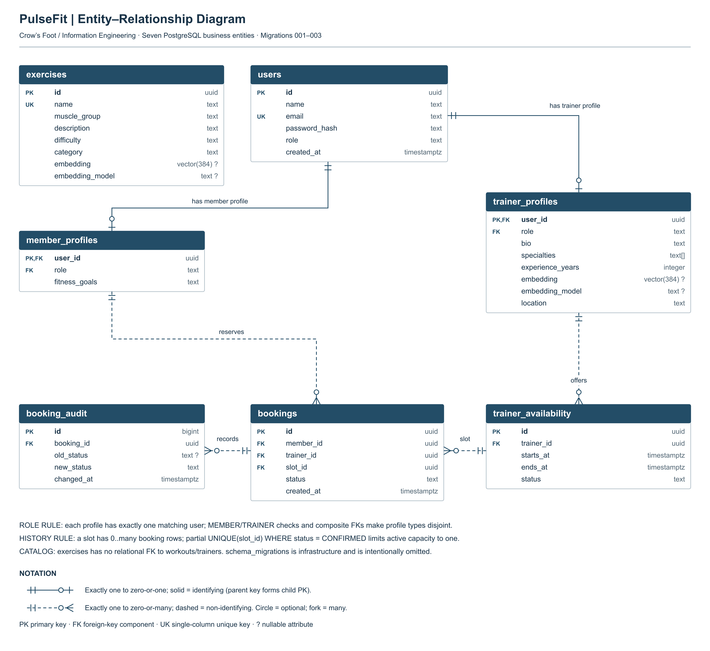

# Entity–Relationship diagram — Crow's Foot / Information Engineering

A physical ER model of **seven PostgreSQL business entities**, based on migrations 001–003. This is separate from the [relational schema](RELATIONAL_SCHEMA.md) and [hybrid architecture](HYBRID_DATA_MODEL.md).

[Editable SVG](database-design/pulsefit-er-crows-foot.svg) · [High-resolution PNG](database-design/pulsefit-er-crows-foot.png) · [Editable model/renderer](database-design/README.md) · [Mermaid companion](er-diagram/pulsefit.mmd)

## Notation

Crow's Foot / Information Engineering symbols show both minimum and maximum participation: circle = zero, bar = one, fork = many. Paired bars = exactly one; circle/bar = zero-or-one; circle/fork = zero-or-many. Solid connectors identify relationships in which the parent's key forms the child's PK (profiles). Dashed connectors are non-identifying: the child has an independent PK. Dashed does not mean optional; endpoint circles determine optionality.

All 41 business attributes and actual PostgreSQL types appear, including trainer location from migration 002. PK marks primary keys; FK marks every composite-reference component; UK marks a single-column unique key; ? means nullable. Full defaults/CHECKs/indexes belong in the relational schema rather than being confused with multiplicity.

## Relationships and participation

| Relationship | Parent to child | Each child to parent | Enforced mapping / qualification |
|---|---|---|---|
| users → member_profiles | 0..1 | Exactly 1 | (user_id, role) → users(id, role); profile PK user_id; CHECK role='MEMBER' |
| users → trainer_profiles | 0..1 | Exactly 1 | (user_id, role) → users(id, role); profile PK user_id; CHECK role='TRAINER' |
| trainer_profiles → trainer_availability | 0..many | Exactly 1 | trainer_id → trainer_profiles(user_id), NOT NULL |
| member_profiles → bookings | 0..many | Exactly 1 | member_id → member_profiles(user_id), NOT NULL |
| trainer_availability → bookings | 0..many historical rows | Exactly 1 | (slot_id, trainer_id) → trainer_availability(id, trainer_id), both NOT NULL |
| bookings → booking_audit | 0..many structurally | Exactly 1 | booking_id → bookings(id), NOT NULL; normal insert/status updates append audit |

A parent is not required to have children; every child requires a parent. The audit FK does not require an audit row, although the trigger produces records in normal workflows. These are structural cardinalities, not an assumption that every workflow has already run.

## Constraints beyond connector cardinality

1. **Disjoint profiles:** users.role is MEMBER or TRAINER; CHECK-constrained profile roles and composite FKs prevent a single user satisfying both profile types. SQL does not enforce a profile for every user; application registration creates it transactionally. The 0..1 connectors are intentional.
2. **History versus capacity:** a slot may have many historical/CANCELLED rows and at most one CONFIRMED row. one_confirmed_booking_per_slot is a partial unique index, not unconditional 1:1.
3. **Composite references:** UNIQUE users(id, role) and trainer_availability(id, trainer_id) are nonminimal superkeys enabling exact FK targets; id alone is already a PK. bookings.trainer_id is part of the composite FK, not an invented standalone reference.
4. **Temporal integrity:** GiST exclusion prevents same-trainer overlapping intervals, including CLOSED slots. Triggers enforce windows, immutable identities/times and occupied closure rules; these predicates are not expressible merely as a fork/bar.
5. **Independent catalog:** exercises has no FK to trainers, bookings or Mongo workout snapshots. Its unconnected placement is deliberate.

schema_migrations is infrastructure, not an eighth business entity. Policies/views/functions are implementation objects, not entities. MongoDB is excluded from this SQL ER model; pgvector attributes remain inside the PostgreSQL relations that store them.

## Viva explanation

“Each user may have a typed profile, but each profile requires one correctly typed user. Trainers offer slots; members reserve them. A slot has many historical booking rows, while a partial index limits confirmed capacity to one. Audit is a booking child; exercises stands alone. Next I show exact keys/constraints in the relational diagram and database boundaries in the hybrid figure.”

## Verification and convention

[Validation checklist](database-design/VALIDATION.md) records source/catalog comparison and actual visual review. [Mermaid's ER convention reference](https://mermaid.js.org/syntax/entityRelationshipDiagram.html) documents the same cardinality/identification semantics. This uses accepted academic notation; no certification to a named ISO drawing standard is claimed.
