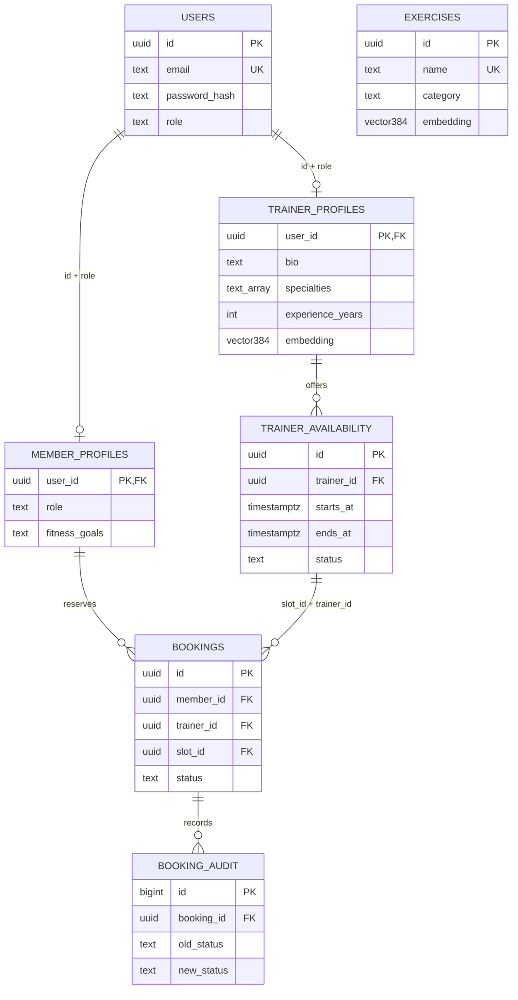

# Entity relationship diagram

Logical cross-database reference: `workout_logs.userId` stores the PostgreSQL member UUID as a string. It is not a MongoDB-enforced foreign key. Exercises embedded in logs preserve historical names and measurements even if catalog descriptions change. The optional catalog has no forced relational link to those historical snapshots.
