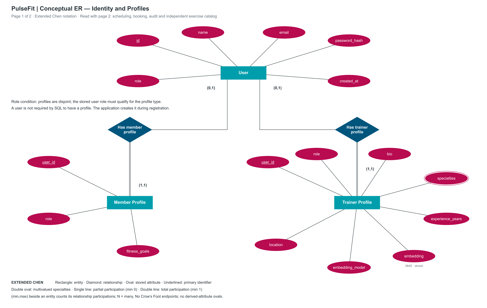
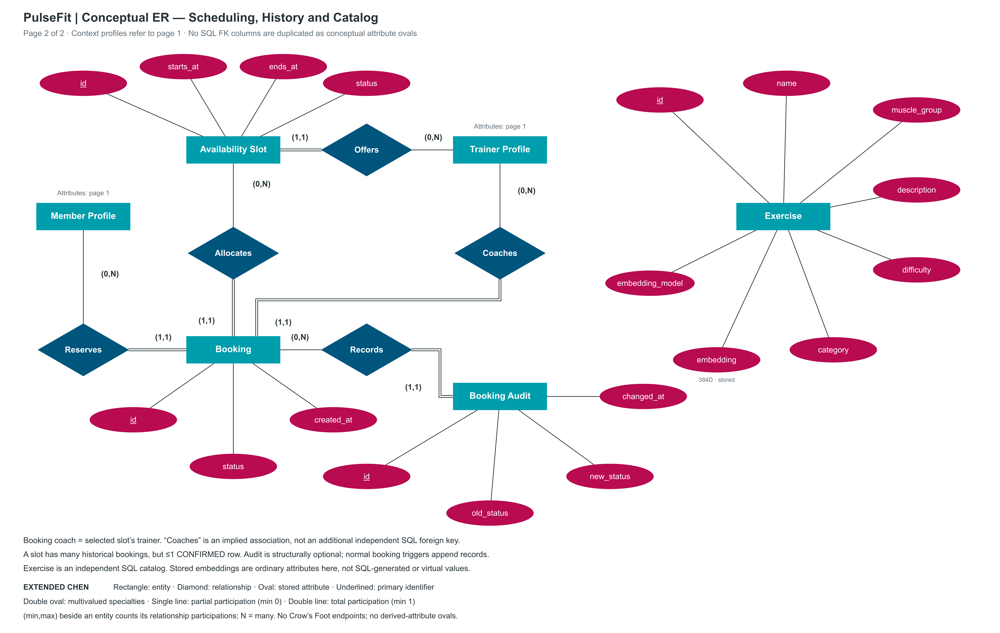

# Conceptual ER diagram — extended Chen notation

**User-approved academic design for PR #5.** Two landscape pages replace the previous Crow's Foot presentation as the conceptual view.

| Page | SVG / editable vector | High-resolution PNG |
|---|---|---|
| 1 — Identity and profiles | [SVG](database-design/pulsefit-er-conceptual-identity.svg) | [6000 × 3800 PNG](database-design/pulsefit-er-conceptual-identity.png) |
| 2 — Scheduling, history and catalog | [SVG](database-design/pulsefit-er-conceptual-booking.svg) | [6000 × 3800 PNG](database-design/pulsefit-er-conceptual-booking.png) |

[Three-page review PDF](database-design/pulsefit-conceptual-and-academic-review.pdf) includes both conceptual pages and the separate [academic relational schema](RELATIONAL_SCHEMA.md). [Editable source and validation](database-design/README.md).

## Chosen convention

This is **extended Chen notation**, without Crow's Foot endpoints. Teal rectangles are entities; dark blue diamonds contain relationship verbs; magenta ovals are attributes. Primary identifiers are underlined. The double oval is used only for the genuinely multivalued specialties array. It denotes multiple values, not a guarantee of a nonempty array, set semantics or a normalized specialty relation.

A single entity–relationship connection means partial participation (minimum zero). A double connection means total participation (minimum one). **(min,max) beside an entity counts how many instances of that relationship each instance of that entity participates in**; N means many. These labels are read using Chen participation semantics, not Crow's Foot look-across endpoints. The same convention is used on both pages.

No dashed derived-attribute oval is used: embedding is persisted, application-maintained data, not a virtual or SQL-generated attribute. Both actual embedding attributes remain with Trainer Profile and Exercise, annotated 384D/stored. Nullability, types and constraints remain explicit in the physical schema.

## Cardinality and participation validation

| Relationship diamond | First entity participation | Second entity participation | Basis / limit |
|---|---|---|---|
| User — Has member profile — Member Profile | User (0,1), partial | Member Profile (1,1), total | Profile PK/shared UUID; fixed MEMBER role and composite reference |
| User — Has trainer profile — Trainer Profile | User (0,1), partial | Trainer Profile (1,1), total | Profile PK/shared UUID; fixed TRAINER role and composite reference |
| Trainer Profile — Offers — Availability Slot | Trainer (0,N), partial | Slot (1,1), total | NOT NULL typed trainer reference |
| Member Profile — Reserves — Booking | Member (0,N), partial | Booking (1,1), total | NOT NULL member reference |
| Availability Slot — Allocates — Booking | Slot (0,N), partial | Booking (1,1), total | NOT NULL slot/trainer pair; historical rows remain many |
| Booking — Records — Booking Audit | Booking (0,N), partial | Audit (1,1), total | Audit FK requires a booking; FK alone does not require an audit row |
| Trainer Profile — Coaches — Booking | Trainer (0,N), partial | Booking (1,1), total | **Implied association** through the selected slot; not an additional independent SQL FK |

The page-2 member/trainer rectangles repeat page-1 entities as context, not new entities. There are seven distinct PostgreSQL business entities, six actual FK constraints and seven conceptual relationship diamonds. Exercises remains independent.

## Attribute mapping and implementation boundaries

The two pages draw 36 actual attribute ovals. Five reference-only SQL fields are expressed as relationships instead of redundant attribute spokes:

| Physical field | Conceptual representation |
|---|---|
| trainer_availability.trainer_id | Offers |
| bookings.member_id | Reserves |
| bookings.slot_id | Allocates |
| bookings.trainer_id | Coaches, constrained to equal the selected slot's trainer |
| booking_audit.booking_id | Records |

The profile user_id attributes remain underlined identifiers, and role is retained as an actual constrained domain attribute. SQL FK labels/composite details are not placed on the ovals. All **41 business columns**, types and exact six FK mappings are retained in the separate academic/physical schema views. No business attribute was invented.

Role checks make the profile types disjoint. SQL does not require every user to have a profile; registration creates the appropriate one. The model therefore does not assert total user specialization. Profiles could alternatively be represented as EER subtypes, but this view uses explicit role-qualified relationships as requested.

A slot has multiple historical bookings and at most one CONFIRMED booking, enforced by the partial unique index. The booking coach must equal the selected slot's trainer through the physical composite FK. These are accompanying conditions, not unconditional 1:1 connectors. Normal triggers append audit records; the structural parent-to-audit minimum remains zero.

MongoDB workout_logs, its logical member UUID and application-managed integrity remain exclusively in [HYBRID_DATA_MODEL.md](HYBRID_DATA_MODEL.md). pgvector is a PostgreSQL extension, not a third database server. schema_migrations is infrastructure, not an ER business entity.

## Viva explanation

“Rectangles are business entities, diamonds are relationships and ovals are attributes. The min/max label describes each entity's own participation; double lines require participation. User profiles are optional and role-qualified. Booking relates to one member, slot and its corresponding trainer, with many historical rows per slot. Active capacity and coach consistency require the separate physical constraints. The independent exercise catalog and stored embeddings remain PostgreSQL entities/attributes.”

## Local validation

[Local review record](database-design/LOCAL_REVIEW.md) records implementation comparisons, full-resolution visual review, PDF checks and preserved files. The old Crow's Foot figures remain superseded physical-reference artifacts, not the current conceptual notation. The Mermaid companion remains explicitly a physical relationship aid; the editable conceptual source is render-reference-diagrams.mjs plus schema-model.json.
