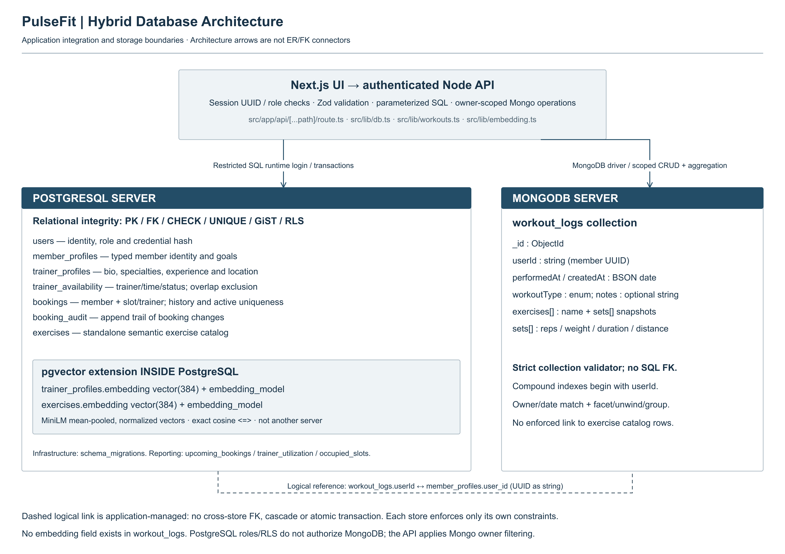

# Hybrid database architecture and data model

[Editable SVG](database-design/pulsefit-hybrid-architecture.svg) · [High-resolution PNG](database-design/pulsefit-hybrid-architecture.png) · [Editable source](database-design/README.md)

This architecture uses integration arrows and a dashed logical-reference line. It is not an ER diagram and does not imply FK constraints across storage boundaries. See the separate [ER](ER_DIAGRAM.md) and [relational schema](RELATIONAL_SCHEMA.md) figures.

## PostgreSQL and pgvector

Seven business relations store identity, typed profiles, slots, bookings/audit and exercise catalog. schema_migrations is infrastructure. PostgreSQL enforces local PK/FK/CHECK/UNIQUE/exclusion constraints and RLS. Migrations use a maintenance identity; the API uses a separate restricted non-owner connection configured by scripts/rbac.ts. Application/database source: src/app/api/[...path]/route.ts and src/lib/db.ts.

**pgvector is an extension within this same PostgreSQL server.** Embeddings are stored only in trainer_profiles.embedding vector(384) and exercises.embedding vector(384), each nullable and paired with embedding_model text. Genuine Xenova/all-MiniLM-L6-v2 inference uses mean pooling/L2 normalization in src/lib/embedding.ts. scripts/embed.ts generates initial embeddings; API profile updates regenerate trainer embeddings. The query goal vector is generated for retrieval, not stored in a Mongo field. Exact cosine distance `<=>` produces similarity `1 - distance`. No ANN index or separate vector server is implemented.

## MongoDB

workout_logs embeds historical exercise/set snapshots: _id ObjectId; userId string; performedAt/createdAt BSON date; workoutType enum; optional notes; exercises[] with name and sets[] containing reps/weight/duration/distance. database/mongo/setup.ts supplies the strict validator and (userId, performedAt DESC) / (userId, workoutType, performedAt DESC) indexes. src/lib/workouts.ts implements owner/date-scoped aggregation with separate session/measurement facets.

workout_logs.userId stores the PostgreSQL member UUID as a string. **It is application-managed, not an SQL or Mongo-enforced cross-store FK.** The validator's string pattern does not look up a real member. There is no cross-store FK, cascade, referential join constraint or distributed atomic transaction. Exercise names are snapshots, not references to exercises.id.

PostgreSQL RLS does not authorize MongoDB. The trusted API authenticates/scopes Mongo owner operations. Each store enforces its own local rules. Credentials remain server-side and are omitted from all figures.

## Viva explanation

“The API coordinates two database servers. PostgreSQL supplies relational integrity and pgvector search in that same server; MongoDB handles flexible workout documents and aggregation. The dashed UUID link is logical, so it is not a foreign key or a distributed ACID guarantee. Embeddings live on trainers/exercises, not in a third database.”
