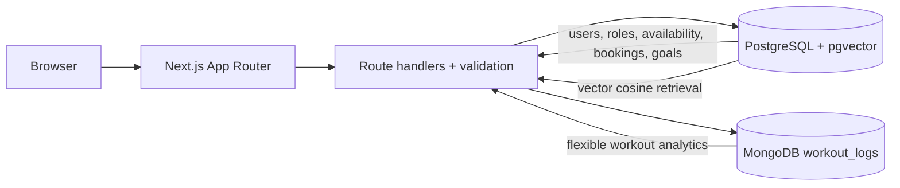

# PulseFit database architecture

PostgreSQL owns identity, roles, trainer profiles, time slots, bookings, fitness goals and vectors. Its constraints provide reliable transactions and prevent schedule conflicts. MongoDB stores evolving workout/exercise shapes and uses aggregation pipelines for training analytics. pgvector stores 128D embeddings alongside PostgreSQL metadata and ranks by cosine distance. The current local embedding generator uses deterministic token/bigram feature hashing, requiring no external API key.
