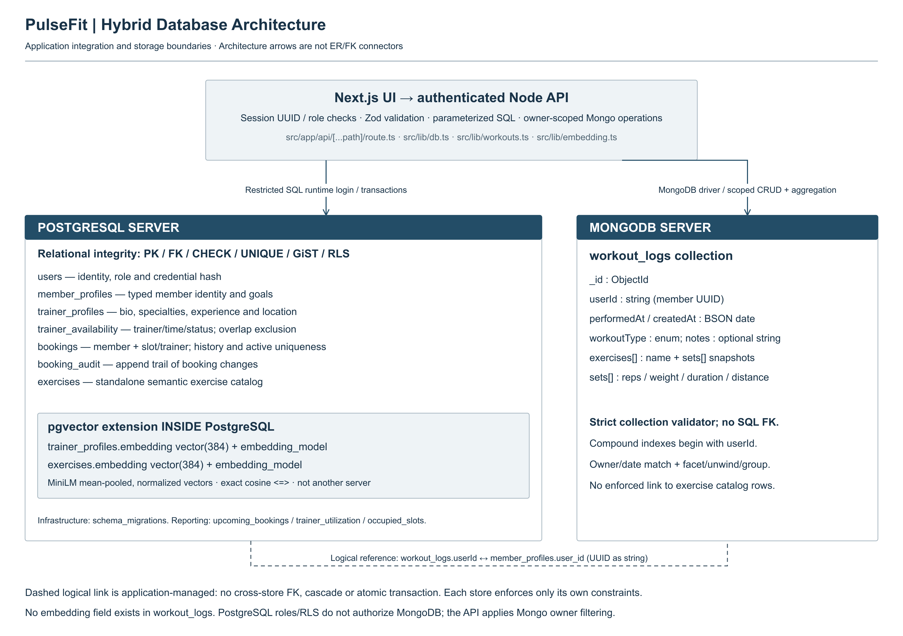

# PulseFit architecture

[Editable SVG and storage-boundary explanation](../HYBRID_DATA_MODEL.md). For cardinalities use the separate [ER](../ER_DIAGRAM.md); for exact columns/constraints use the [relational schema](../RELATIONAL_SCHEMA.md).

PostgreSQL owns users, typed profiles, availability, bookings, audit, exercise catalog and embeddings. MongoDB owns flexible workout documents and progress aggregation. PostgreSQL UUIDs in MongoDB are logical references, not cross-database foreign keys. No distributed transaction is claimed. The backend sets the verified actor UUID transaction-locally; PostgreSQL independently resolves its role for row policies. End users never receive database credentials. Model inference uses Xenova/all-MiniLM-L6-v2 with mean pooling, normalization and 384 dimensions. There is no keyword/hash fallback. The small catalog uses exact cosine distance (<=>), without claiming an ANN index.
