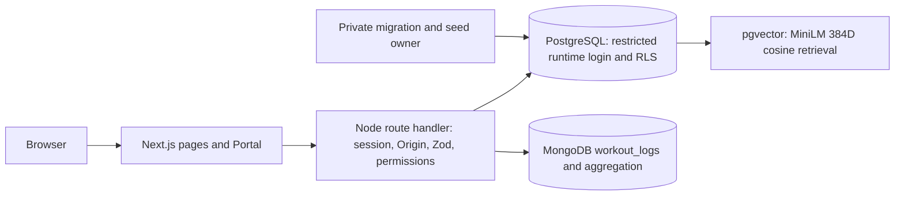

# PulseFit architecture

PostgreSQL owns users, typed profiles, availability, bookings, audit, exercise catalog and embeddings. MongoDB owns flexible workout documents and progress aggregation. PostgreSQL UUIDs in MongoDB are logical references, not cross-database foreign keys. No distributed transaction is claimed. The backend sets the verified actor UUID transaction-locally; PostgreSQL independently resolves its role for row policies. End users never receive database credentials. Model inference uses Xenova/all-MiniLM-L6-v2 with mean pooling, normalization and 384 dimensions. There is no keyword/hash fallback. The small catalog uses exact cosine distance (<=>), without claiming an ANN index.
